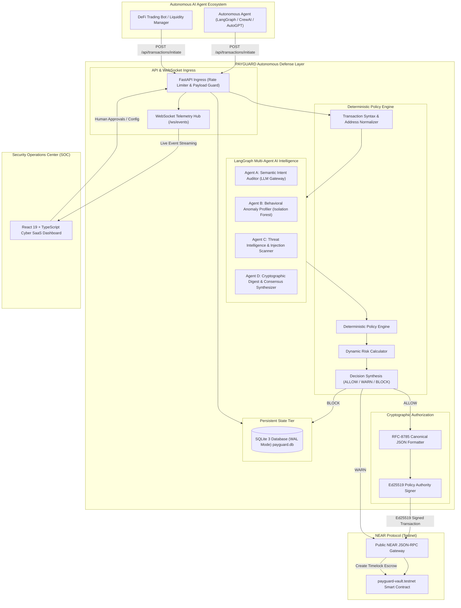
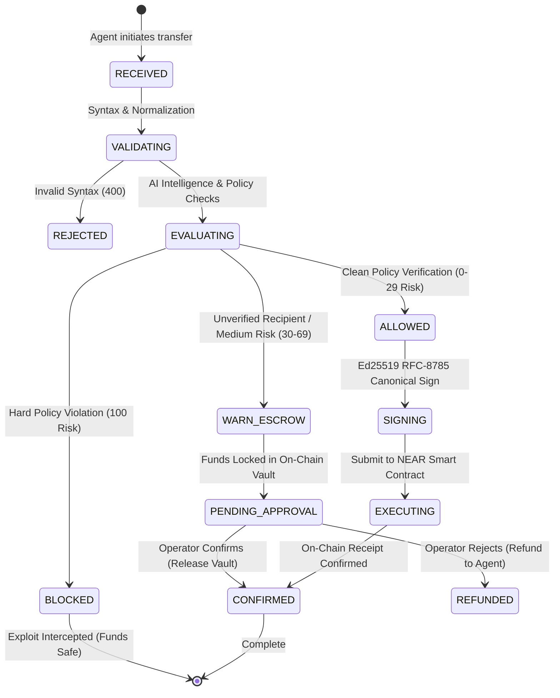

# PAYGUARD — System Architecture Specification
## Multi-Tier Defense Architecture, Autonomous Agent Telemetry & Cryptographic Verification

**Project:** PAYGUARD — Autonomous Agent Financial Defense Layer  
**Document Version:** 2.0.0 (Phase 9 Release)  
**NEAR Hackathon 2026:** AI Security & Defense (SEC) | Agent Economy (AGT)

---

## 1. Architectural Philosophy

PAYGUARD is an intelligent, deterministic transaction authorization middleware situated between autonomous AI agents and blockchain networks (NEAR Protocol).

### The Inviolable Core Principle:
```
AI analyzes. The policy engine enforces. The smart contract protects.
```

- **AI is strictly advisory:** Machine learning models, LLMs, and behavioral heuristics analyze natural language intent and compute anomaly indicators. An AI model **NEVER** holds on-chain execution keys and **CANNOT** override a deterministic policy `BLOCK`.
- **The Policy Engine is authoritative:** Enforces deterministic invariants (per-transaction limits, 24-hour rolling velocity limits, address blocklists/whitelists, duplicate transaction sliding windows).
- **The Smart Contract is guardian:** The on-chain vault safely holds funds in escrow and releases tokens only upon validating a cryptographic signature produced by the policy authority over an RFC-8785 canonical hash.

---

## 2. End-to-End System Architecture



---

## 3. Subsystem Breakdown & Responsibilities

### 3.1 Ingress & Security Middleware (`backend/app/main.py`)
- **Payload Size Enforcement:** Rejects request payloads greater than 1,048,576 bytes (1 MB) with `HTTP 413`.
- **IP Rate Limiting:** Sliding-window throttle allowing up to 180 requests/minute per client on evaluation endpoints (`HTTP 429`).
- **Security Headers:** Injects `X-Frame-Options: DENY`, `X-Content-Type-Options: nosniff`, and `Content-Security-Policy` across all responses.
- **CORS Whitelisting:** Configured dynamically via environment variables (`CORS_ORIGINS`).

### 3.2 LangGraph Multi-Agent Ensemble (`backend/app/agents/`)
- **Agent A (Intent Auditing):** Parses declared natural language task intent and cross-checks against actual recipient and amount parameters to detect stealth redirects. Filters out prompt injection and role hijacking attempts.
- **Agent B (Behavioral Profiling):** Evaluates transaction velocity, recipient novelty, and spending frequency using an in-memory Isolation Forest anomaly detection algorithm.
- **Agent C (Threat Intelligence):** Intercepts interactions with known malicious addresses, blacklisted contracts, and adversarial prompt signatures.
- **Agent D (Consensus Synthesizer):** Synthesizes findings across agents into explainable four-quadrant risk reports and generates cryptographic evidence digests.

### 3.3 Deterministic Policy Engine (`backend/app/engine/`)
- Pure algorithmic enforcement operating with zero external network dependencies.
- Evaluates:
  1. Maximum single transaction amount (e.g. 50.0 NEAR).
  2. Cumulative rolling 24-hour spending limit (e.g. 200.0 NEAR).
  3. Trusted ecosystem whitelists and malicious address blocklists.
  4. 120-second sliding-window duplicate transaction detection.

### 3.4 Cryptographic Authorization Engine (`backend/app/blockchain/`)
- **RFC-8785 Canonical JSON Serialization:** Normalizes key ordering, whitespace, and numerical precision.
- **SHA-256 Digest:** Produces immutable 32-byte hash of authorized transaction parameters.
- **Ed25519 Native Signatures:** Signs the canonical digest using a dedicated authority private key. The resulting signature is passed on-chain.

### 3.5 Persistent Storage Engine (`backend/app/db/`)
- High-concurrency SQLite repository running in Write-Ahead Logging (`PRAGMA journal_mode = WAL`) mode with foreign key enforcement.
- Thread-safe access guaranteed through Python's `threading.RLock`.
- Manages 11 distinct schemas: `transactions`, `events`, `agent_executions`, `security_findings`, `authorization_evidence`, `policies`, etc.

### 3.6 Smart Contract Vault (`contracts/payguard-vault`)
- Implemented in Rust using NEAR SDK 5.5.0 (`cdylib` target).
- Features:
  - `authorize_and_transfer`: Verifies Ed25519 signature on-chain via host function `env::ed25519_verify`. Transfers funds directly if signature is valid and nonce has not been executed.
  - `create_escrow`: Locks funds in contract for `WARN` decisions.
  - `release_escrow` & `refund_escrow`: Human operator authorized fund release or refund.
  - `pause` & `unpause`: Immediate circuit breaker for owner.

---

## 4. Transaction Lifecycle State Machine



---

## 5. Telemetry & WebSocket Event Model

The WebSocket broadcaster (`/ws/events`) streams lifecycle events in real time to connected dashboards:
1. `transaction.received` — Initial transaction receipt.
2. `transaction.analyzing` — AI and policy evaluations underway.
3. `transaction.evaluated` — ALLOW, WARN, or BLOCK verdict synthesized.
4. `security.threat_intercepted` — Malicious payload or address blocked.
5. `escrow.created` — Vault escrow locked for human review.
6. `escrow.released` / `escrow.refunded` — Operator action executed.
7. `blockchain.receipt_confirmed` — Finalized on-chain block receipt.
