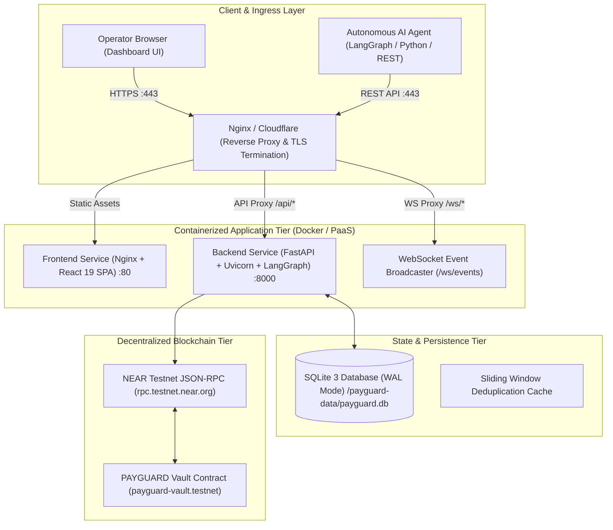

# PAYGUARD — Production Deployment Guide
## Complete Multi-Platform Deployment, Containerization, and Operational Runbook

**Project:** PAYGUARD — Autonomous Agent Financial Defense Layer  
**Target Environments:** Local Docker, Cloud VPS / PaaS, NEAR Testnet  
**Document Version:** 1.0.0 (Phase 9 Release)

---

## 1. Executive Summary & Deployment Architecture

PAYGUARD is an enterprise-grade defense middleware platform designed to protect autonomous AI agents from unauthorized, excessive, or malicious financial transactions on NEAR Protocol. The production topology consists of four decoupled layers:



---

## 2. Prerequisites & System Requirements

### Hardware Sizing
| Resource | Minimum (Development) | Recommended (Production) |
| :--- | :--- | :--- |
| **CPU** | 2 vCPU cores | 4 vCPU cores (x86-64 or ARM64) |
| **Memory** | 2 GB RAM | 4 GB - 8 GB RAM |
| **Disk Storage** | 10 GB SSD | 40 GB NVMe SSD (Persistent volume for SQLite WAL) |
| **Network** | 10 Mbps egress | 100 Mbps egress with low-latency link to NEAR RPC |

### Software Dependencies
- **Docker Engine:** v24.0+ & Docker Compose v2.20+
- **Python (for bare-metal):** v3.11+
- **Node.js (for bare-metal build):** v20.x LTS or v22.x
- **Rust Toolchain (for contract compilation):** v1.80+ with `wasm32-unknown-unknown`
- **NEAR CLI RS:** v0.17+ (`cargo install near-cli-rs`)

---

## 3. Containerized Deployment (Docker Compose)

Docker Compose provides the fastest, fully reproducible production setup with isolated networks, non-root user execution, and persistent database volumes.

### Step 1: Clone Repository and Configure Secrets
```bash
# 1. Clone the repository
git clone https://github.com/your-org/payguard.git
cd payguard

# 2. Copy the production environment template
cp .env.example .env

# 3. Configure production secrets in .env
# Edit .env to set secure production CORS domains, LLM API keys, and NEAR testnet IDs
# IMPORTANT: When ENVIRONMENT=production, POLICY_SIGNER_PRIVATE_KEY is strictly required.
# The server will abort startup if an ephemeral key is used in production mode.
nano .env
```

### Step 2: Build and Start Containers
```bash
# Build multi-stage images and start in background
docker compose up -d --build
```

### Step 3: Verify Container Health & Readiness
```bash
# Check status of containers
docker compose ps

# Expected Output:
# NAME                IMAGE               COMMAND                  SERVICE             STATUS                    PORTS
# payguard-backend    payguard-backend    "uvicorn app.main:ap…"   backend             Up (healthy) :8000->8000/tcp
# payguard-frontend   payguard-frontend   "/docker-entrypoint.…"   frontend            Up (healthy) :80->80/tcp, :5173->80/tcp
```

### Step 4: Validate Subsystem Health Probe
```bash
# Probe backend basic health endpoint
curl -i http://localhost:8000/api/health

# Probe deep subsystem health diagnostics
curl -i http://localhost:8000/api/events/monitoring/health
```

### Step 5: Tail Container Logs
```bash
# View combined real-time logs
docker compose logs -f

# Tail backend service logs only
docker compose logs -f backend
```

---

## 4. Standalone Bare-Metal / VPS Deployment

For production deployments on Linux VPS (Ubuntu 22.04 / Debian 12) using Systemd and Nginx:

### A. Backend Service Setup (Systemd)

1. **Install System Dependencies:**
   ```bash
   sudo apt update && sudo apt install -y python3.11 python3.11-venv python3-pip curl build-essential
   ```

2. **Create Dedicated System User:**
   ```bash
   sudo useradd -r -s /bin/false -d /opt/payguard payguard
   sudo mkdir -p /opt/payguard /var/log/payguard /var/lib/payguard
   ```

3. **Deploy Code & Python Virtual Environment:**
   ```bash
   sudo git clone https://github.com/your-org/payguard.git /opt/payguard/repo
   cd /opt/payguard/repo/backend
   python3.11 -m venv /opt/payguard/venv
   /opt/payguard/venv/bin/pip install --upgrade pip
   /opt/payguard/venv/bin/pip install -r requirements.txt
   ```

4. **Configure Systemd Unit File (`/etc/systemd/system/payguard-backend.service`):**
   ```ini
   [Unit]
   Description=PAYGUARD Autonomous Agent Financial Security Backend
   After=network.target

   [Service]
   Type=simple
   User=payguard
   Group=payguard
   WorkingDirectory=/opt/payguard/repo/backend
   Environment="PYTHONPATH=/opt/payguard/repo/backend"
   Environment="DATABASE_PATH=/var/lib/payguard/payguard.db"
   Environment="HOST=127.0.0.1"
   Environment="PORT=8000"
   Environment="ENVIRONMENT=production"
   Environment="DEBUG=false"
   EnvironmentFile=/etc/payguard/production.env
   ExecStart=/opt/payguard/venv/bin/uvicorn app.main:app --host 127.0.0.1 --port 8000 --workers 2 --access-log
   Restart=always
   RestartSec=5s
   LimitNOFILE=65536

   [Install]
   WantedBy=multi-user.target
   ```

5. **Start and Enable Service:**
   ```bash
   sudo systemctl daemon-reload
   sudo systemctl enable --now payguard-backend
   sudo systemctl status payguard-backend
   ```

---

### B. Frontend Static Asset Build & Web Server

1. **Build Static Bundle:**
   ```bash
   cd /opt/payguard/repo/frontend
   npm ci
   VITE_API_URL="/api" VITE_WS_URL="/ws/events" npm run build
   # Static assets compiled into /opt/payguard/repo/frontend/dist
   ```

2. **Configure Nginx Site (`/etc/nginx/sites-available/payguard.conf`):**
   ```nginx
   server {
       listen 80;
       server_name payguard.example.com;
       return 301 https://$host$request_uri;
   }

   server {
       listen 443 ssl http2;
       server_name payguard.example.com;

       ssl_certificate /etc/letsencrypt/live/payguard.example.com/fullchain.pem;
       ssl_certificate_key /etc/letsencrypt/live/payguard.example.com/privkey.pem;
       ssl_protocols TLSv1.2 TLSv1.3;
       ssl_ciphers HIGH:!aNULL:!MD5;

       root /opt/payguard/repo/frontend/dist;
       index index.html;

       # Security Headers
       add_header X-Frame-Options "DENY" always;
       add_header X-Content-Type-Options "nosniff" always;
       add_header Referrer-Policy "strict-origin-when-cross-origin" always;
       add_header Content-Security-Policy "default-src 'self'; connect-src 'self' https: wss:; font-src 'self' data:; img-src 'self' data: https:; script-src 'self'; style-src 'self' 'unsafe-inline';" always;

       # Frontend SPA Routing
       location / {
           try_files $uri $uri/ /index.html;
       }

       # Backend API Reverse Proxy
       location /api/ {
           proxy_pass http://127.0.0.1:8000/api/;
           proxy_http_version 1.1;
           proxy_set_header Host $host;
           proxy_set_header X-Real-IP $remote_addr;
           proxy_set_header X-Forwarded-For $proxy_add_x_forwarded_for;
           proxy_set_header X-Forwarded-Proto $scheme;
       }

       # WebSocket Telemetry Reverse Proxy
       location /ws/ {
           proxy_pass http://127.0.0.1:8000/ws/;
           proxy_http_version 1.1;
           proxy_set_header Upgrade $http_upgrade;
           proxy_set_header Connection "upgrade";
           proxy_set_header Host $host;
           proxy_set_header X-Real-IP $remote_addr;
           proxy_set_header X-Forwarded-For $proxy_add_x_forwarded_for;
           proxy_read_timeout 86400s;
           proxy_send_timeout 86400s;
       }
   }
   ```

3. **Enable Site & Obtain TLS Certificate:**
   ```bash
   sudo ln -s /etc/nginx/sites-available/payguard.conf /etc/nginx/sites-enabled/
   sudo certbot --nginx -d payguard.example.com
   sudo systemctl reload nginx
   ```

---

## 5. Cloud Platform Recommendations & Evaluation

When evaluating modern cloud hosting providers for PAYGUARD, compatibility with persistent SQLite, WebSockets, and NEAR RPC is critical:

| Platform | Frontend Compatibility | Backend Compatibility | SQLite Persistence | WebSocket Support | Overall Recommendation |
| :--- | :--- | :--- | :--- | :--- | :--- |
| **Fly.io** | Excellent (Static) | Outstanding (Docker) | **Native NVMe Volumes** (`fly volumes`) | Native Support | **TOP CHOICE (Recommended for Full Stack)** |
| **Render** | Excellent (Static Site) | Good (Web Service) | Supported (Persistent Disk attached) | Supported | **Strong Alternative** |
| **AWS Lightsail / EC2** | Complete control | Complete control | EBS Persistent Volume | Full Native Support | **Best for Enterprise / Self-Hosted** |
| **Vercel / Netlify** | Outstanding | Serverless only (Timeout limits) | Incompatible with SQLite | Problematic for long-lived WS | **Frontend Only** |

### Fly.io Deployment Blueprint (Quickstart)
Fly.io provides first-class support for single-region SQLite applications with attached volumes:
```toml
# fly.toml
app = "payguard-defense"
primary_region = "iad"

[build]
  dockerfile = "backend/Dockerfile"

[mounts]
  source = "payguard_data"
  destination = "/app/data"

[http_service]
  internal_port = 8000
  force_https = true
  auto_stop_machines = false
  auto_start_machines = true
  min_machines_running = 1

[[services.ports]]
  handlers = ["http"]
  port = 80

[[services.ports]]
  handlers = ["tls", "http"]
  port = 443
```

---

## 6. Database Durability, Persistence & Backup Runbook

PAYGUARD relies on SQLite configured in Write-Ahead Logging (WAL) mode (`PRAGMA journal_mode = WAL`). WAL mode enables concurrent reads while a write transaction is executing, preventing database lock contention.

### Online Zero-Downtime Backup Procedure
To create a consistent, non-corrupt backup without stopping the backend:

```bash
# Execute safe online SQLite backup using the SQLite backup API
sqlite3 /app/data/payguard.db ".backup '/app/data/backups/payguard_backup_$(date +%Y%m%d_%H%M%S).db'"
```

### Automated Nightly Backup Cron Job
Place this script in `/etc/cron.daily/payguard-backup`:
```bash
#!/bin/bash
set -euo pipefail

BACKUP_DIR="/var/backups/payguard"
DB_PATH="/var/lib/payguard/payguard.db"
TIMESTAMP=$(date +%Y%m%d_%H%M%S)
DEST="$BACKUP_DIR/payguard_$TIMESTAMP.db"

mkdir -p "$BACKUP_DIR"
sqlite3 "$DB_PATH" ".backup '$DEST'"

# Compress and retain 14 days of backups
gzip "$DEST"
find "$BACKUP_DIR" -type f -name "payguard_*.db.gz" -mtime +14 -delete

logger -t payguard-backup "Completed automated hot backup: $DEST.gz"
```

### Database Restore Procedure
In the event of database corruption or hardware replacement:
```bash
# 1. Stop backend service
sudo systemctl stop payguard-backend # or docker compose stop backend

# 2. Archive corrupted database
mv /var/lib/payguard/payguard.db /var/lib/payguard/payguard_corrupted_$(date +%s).db

# 3. Restore from uncompressed backup
gunzip -c /var/backups/payguard/payguard_20261114_000000.db.gz > /var/lib/payguard/payguard.db
chown payguard:payguard /var/lib/payguard/payguard.db
chmod 640 /var/lib/payguard/payguard.db

# 4. Restart service and verify health
sudo systemctl start payguard-backend
curl http://localhost:8000/api/health
```

---

## 7. NEAR Testnet Smart Contract Deployment Runbook

### Prerequisites
- Build the optimized WASM artifact:
  ```bash
  cargo build --target wasm32-unknown-unknown --release --manifest-path contracts/payguard-vault/Cargo.toml
  ```
  The compiled artifact is generated at:  
  `contracts/payguard-vault/target/wasm32-unknown-unknown/release/payguard_vault.wasm`

### Step-by-Step Contract Deployment
1. **Login or Create Testnet Account:**
   ```bash
   near account create-account sponsor-by-faucet-service payguard-vault.testnet autogenerate-new-keypair save-to-keychain network-config testnet
   ```

2. **Deploy Contract WASM:**
   ```bash
   near contract deploy payguard-vault.testnet \
       use-file contracts/payguard-vault/target/wasm32-unknown-unknown/release/payguard_vault.wasm \
       without-init-call \
       network-config testnet \
       sign-as payguard-vault.testnet
   ```

3. **Initialize the Contract:**
   ```bash
   near contract call-function as-transaction payguard-vault.testnet initialize \
       json-args '{
           "owner_id": "payguard-admin.testnet",
           "authority_public_key": "ed25519:6E8sWV5kgVvNu85VaU9b7sE7qN8V3k8Z1r7W4y8v4X3k",
           "timelock_duration_ns": "86400000000000"
       }' \
       prepaid-gas '100.0 Tgas' \
       attached-deposit '0 NEAR' \
       sign-as payguard-vault.testnet \
       network-config testnet
   ```

4. **Verify Contract State & Status:**
   ```bash
   near contract call-function as-read-only payguard-vault.testnet get_status \
       text-args '' \
       network-config testnet
   ```

---

## 8. Rollback Procedures & Incident Response

| Incident Scenario | Detection Signal | Rollback Action |
| :--- | :--- | :--- |
| **Backend crash loop on new deployment** | Health check fails on `/api/health` | Revert Docker tag: `docker compose down && git checkout HEAD~1 && docker compose up -d --build` |
| **Database migration discrepancy** | SQLite schema query errors in logs | Stop service, restore backup using Step 6 restore procedure |
| **NEAR RPC node unreachable** | Health probe reports `DEGRADED (OFFLINE FALLBACK)` | Switch `NEAR_NODE_URL` in `.env` to alternative RPC (`https://rpc.testnet.pagoda.co` or FastNear) and restart backend |
| **Compromised authority key** | Unauthorized signature warning | Call contract `pause` method on-chain immediately via NEAR CLI, rotate backend `NEAR_SIGNER_PRIVATE_KEY`, update contract authority public key, unpause contract |

---

## 9. Verification & Smoke Test Checklist

After deployment, execute this automated smoke check to guarantee all subsystems are operational:

- [ ] **Frontend reachable:** `curl -I https://payguard.example.com` returns `HTTP 200 OK`.
- [ ] **Backend Health:** `curl https://payguard.example.com/api/health` returns `{"status":"healthy"}`.
- [ ] **Deep Diagnostics:** `curl https://payguard.example.com/api/events/monitoring/health` returns `overall_status: "HEALTHY"`.
- [ ] **WebSocket Stream:** Connect to `wss://payguard.example.com/ws/events` and confirm receipt of `system.websocket_connected` event.
- [ ] **Transaction ALLOW Smoke Test:** POST `/api/transactions/initiate` with safe parameters & dry_run=true returns `decision: "ALLOW"`.
- [ ] **Transaction BLOCK Smoke Test:** POST `/api/transactions/initiate` to `malicious-drainer.near` returns `decision: "BLOCK"`.
- [ ] **Transaction WARN Smoke Test:** POST `/api/transactions/initiate` with high value to unverified address returns `decision: "WARN"`.
- [ ] **SQLite Durability:** Restart container (`docker compose restart backend`) and confirm prior transactions persist.

