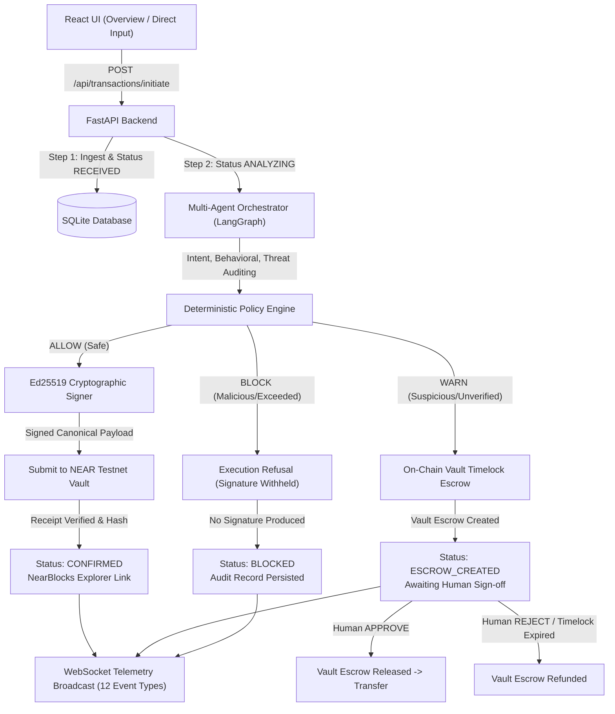

# PAYGUARD — Phase 4: End-to-End Blockchain Integration Plan

**Project:** PAYGUARD (Agent Defense Layer)  
**Hackathon Track:** AI Security & Defense (SEC) / Agent Economy (AGT)  
**Status:** In Execution (Phases 1, 2, and 3 Verified & Passing)

---

## 1. Executive Summary

Phase 4 closes the loop of PAYGUARD: transforming the multi-agent AI risk engine, deterministic policy rules, and the compiled Rust smart contract into a complete end-to-end transaction pipeline.

---

## 2. Phase 4 Target Architecture & Key Deliverables

### A. Core Lifecycle Statuses
1. `RECEIVED` - Agent request validated and persisted with unique transaction ID and nonce.
2. `ANALYZING` - Running multi-agent intent extraction, behavioral anomaly scoring, and prompt injection detection.
3. `ALLOWED` - Policy checks passed; Ed25519 authorization signature generated.
4. `WARN_PENDING_APPROVAL` / `ESCROW_CREATED` - Policy warnings triggered; funds locked in vault timelock escrow.
5. `EXECUTING` - Transaction submitted to NEAR Testnet RPC or contract vault.
6. `CONFIRMED` - Transaction receipt verified on NEAR blockchain with block height and NearBlocks explorer link.
7. `BLOCKED` - Deterministic policy blocked; execution signature strictly withheld.
8. `REJECTED` - Human operator rejected pending escrow; funds refunded to sender.
9. `FAILED` - Network/RPC error with explicit diagnostic details and idempotency lock release.

### B. Backend Implementation Plan
1. **Schema Updates (`backend/app/schemas/transaction.py`):**
   - Define `TransactionStatus` enum with all lifecycle states.
   - Add fields to `TransactionRecord` and `TransactionAnalysisResponse`: `tx_hash`, `block_height`, `block_hash`, `explorer_url`, `escrow_id`, `status`, `error_details`, `execution_mode` ("SIMULATION" vs "ONCHAIN").
   - Define `InitiateTransactionRequest` allowing `dry_run: bool` (default `False`).

2. **Database Migration (`backend/app/db/database.py`):**
   - Automatically inspect `transactions` table schema on startup.
   - Add columns dynamically if missing: `status`, `tx_hash`, `block_height`, `block_hash`, `explorer_url`, `escrow_id`, `error_details`.
   - Update `save_transaction`, `get_transaction`, `list_transactions`, and `get_metrics` to record and aggregate live volumes and counts.

3. **Unified Initiation Pipeline (`backend/app/services/transaction_service.py` & `backend/app/api/routes/transactions.py`):**
   - Implement `POST /api/transactions/initiate`:
     - Checks idempotency (`transaction_id` & `nonce`).
     - Emits `transaction.received`.
     - Executes `multi_agent_orchestrator` & deterministic checks.
     - Emits `transaction.analyzing` and `transaction.evaluated`.
     - Handles decisions:
       - **ALLOW:** Signs canonical message with Ed25519 signer; executes or records via `blockchain_service.execute_or_record_onchain`; verifies testnet receipt; emits `transaction.executing` and `transaction.confirmed`.
       - **WARN:** Signs escrow authorization; creates on-chain vault escrow via `blockchain_service.create_escrow`; records in approval queue; emits `escrow.created`.
       - **BLOCK:** Refuses to generate signature; records exploit/risk findings in `security_findings`; emits `transaction.blocked`.
   - Update `record_human_approval` in `transaction_service.py` and `approvals.py` to synchronize human approval/rejection with on-chain escrow release/refund.

4. **WebSocket Telemetry Streaming (`backend/app/websocket/manager.py`):**
   - Support all 12 events:
     `transaction.received`, `transaction.analyzing`, `transaction.allowed`, `transaction.warned`, `transaction.blocked`, `transaction.executing`, `transaction.confirmed`, `transaction.failed`, `escrow.created`, `escrow.released`, `escrow.refunded`, `metrics.updated`.

### C. Frontend Implementation Plan
1. **Types & Services (`frontend/src/types/index.ts` & `frontend/src/services/api.ts`):**
   - Update `TransactionRecord` and `TransactionRequest` with Phase 4 fields.
   - Add `apiService.initiateTransaction(payload, dryRun)`.
2. **Overview Page (`frontend/src/pages/Overview.tsx`):**
   - Add Mode Toggle: `Live On-Chain (NEAR Testnet)` vs `Dry Run (Policy Simulation)`.
   - Wire transaction initiator directly to `initiateTransaction`.
   - Display real NearBlocks explorer link upon confirmation (`https://testnet.nearblocks.io/txns/{hash}`).
   - Display live verified metrics from backend SQLite.
3. **Transactions Page (`frontend/src/pages/Transactions.tsx`):**
   - Add `STATUS` badge and `NEAR TX HASH` column with external link to NearBlocks.
   - Update modal with 4 tabs: `Policy Checks`, `AI Multi-Agent Logs`, `Cryptographic Evidence`, and `NEAR On-Chain Audit`.
4. **Approvals Page (`frontend/src/pages/Approvals.tsx`):**
   - Display escrow ID, timelock countdown, and transaction receipt on release/refund.
5. **Live Monitoring Page (`frontend/src/pages/LiveMonitoring.tsx`):**
   - Real-time event ticker for all 12 WebSocket events.
   - 6-step lifecycle visualizer for currently executing transactions.

---

## 3. Testing and Verification Strategy
1. **Preserve Existing Tests:**
   - Verify all 43 tests pass without regressions (`backend/tests/test_api_endpoints.py`, `backend/tests/test_phase2_multiagent.py`, `backend/tests/test_phase3_blockchain.py`, `backend/tests/test_policy_engine.py`).
2. **New Phase 4 Automated Test Suite (`backend/tests/test_phase4_end_to_end.py`):**
   - Test 1: Full ALLOW lifecycle (RECEIVED -> ANALYZING -> ALLOWED -> EXECUTING -> CONFIRMED) with valid Ed25519 signature and receipt verification.
   - Test 2: Full WARN lifecycle (RECEIVED -> ANALYZING -> WARN -> ESCROW_CREATED) and subsequent human approval release (`RELEASED`).
   - Test 3: WARN lifecycle rejection (`REFUNDED`).
   - Test 4: Full BLOCK lifecycle (RECEIVED -> ANALYZING -> BLOCKED) verifying execution signature is strictly withheld.
   - Test 5: Replay protection & Idempotency check.
   - Test 6: Dry Run / Simulation mode flag.
   - Test 7: WebSocket event emissions during initiation.
   - Test 8: End-to-end API integration via FastAPI TestClient.
3. **Frontend Compilation:**
   - Execute `npm run build` in `frontend/` to confirm 0 TypeScript or build errors.

---

## 4. Documentation Deliverables
- `docs/PHASE_4_ARCHITECTURE.md`
- `docs/PHASE_4_API_DOCUMENTATION.md`
- `docs/PHASE_4_INTEGRATION_GUIDE.md`
- `docs/PHASE_4_TEST_REPORT.md`
- Update `docs/PHASE_TRACKER.md` and `README.md`

