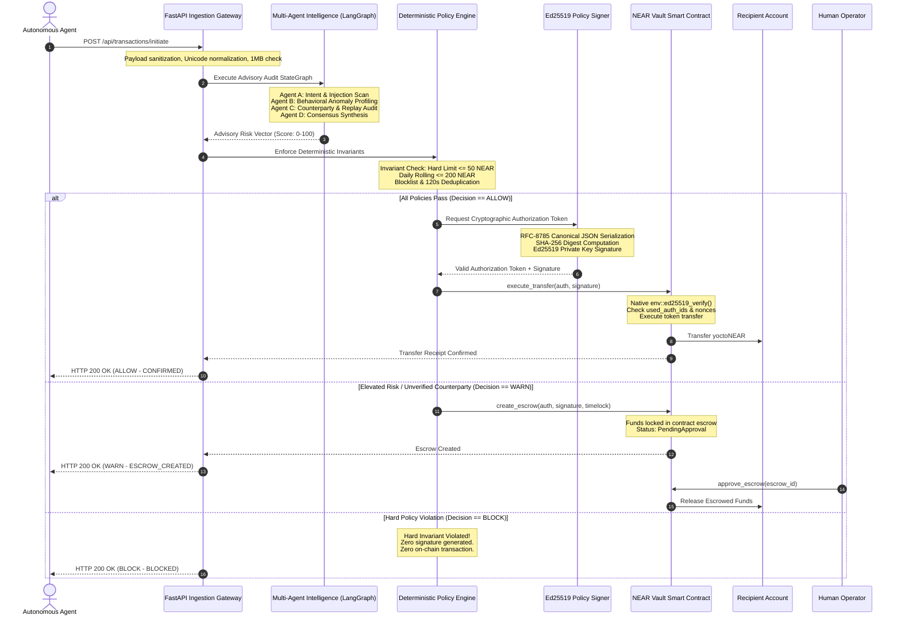
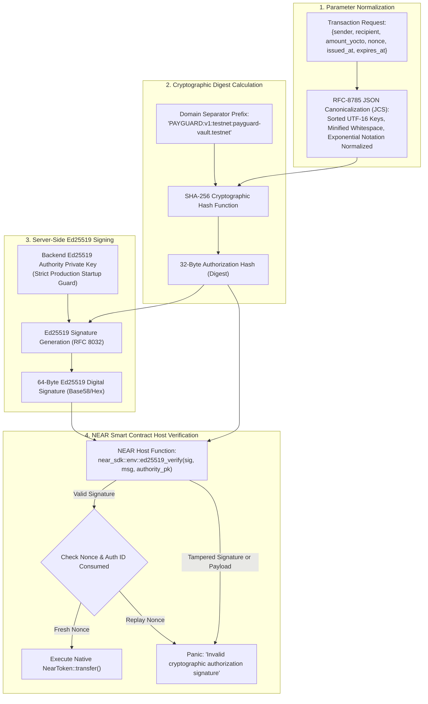
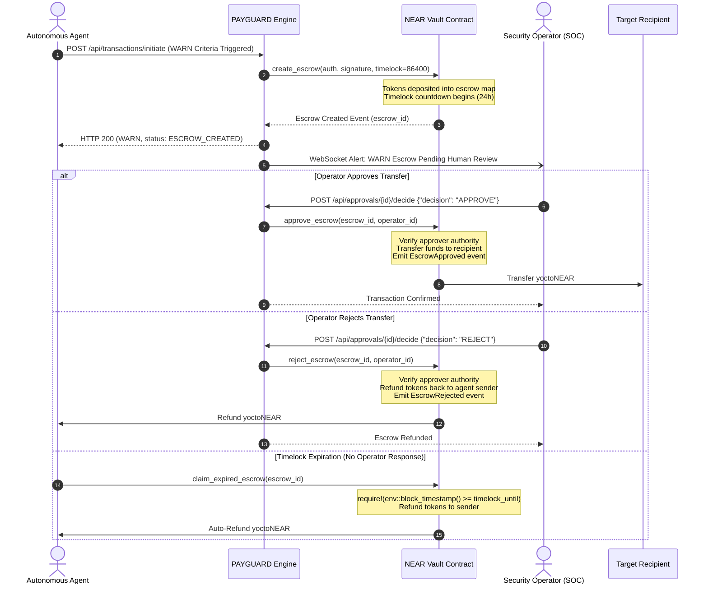
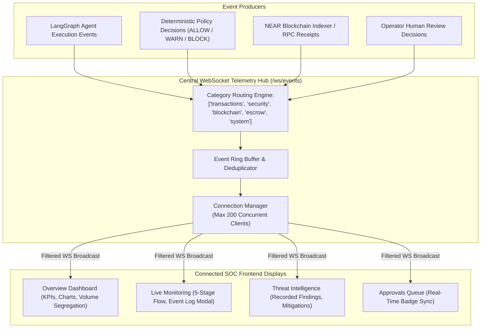

# PAYGUARD — Technical Architecture Specification
## Multi-Tier Autonomous Agent Financial Defense & Smart Contract Authorization Layer

**Project:** PAYGUARD  
**Document Version:** 2.0.0 (Hackathon Final Edition)  
**Classification:** Core System Architecture Specification  
**Core Invariant:** *"AI analyzes. The policy engine enforces. The smart contract protects."*

---

## 1. Executive Architectural Overview

PAYGUARD provides an end-to-end security boundary for autonomous agents interacting with Web3 protocols. The system is architected across four decoupled, defense-in-depth tiers:

1. **Client / Agent Layer:** Autonomous agents (procurement bots, DeFi executors, DAO operators) dispatch transaction intentions via authenticated REST or SDK interfaces.
2. **Advisory Multi-Agent AI Tier (LangGraph):** Coordinated AI agents evaluate semantic intent consistency, behavioral spending velocity, counterparty reputation, and adversarial injection indicators. AI models hold zero private keys and have no execution authority.
3. **Authoritative Deterministic Enforcement Engine:** Mathematical policy engine that strictly enforces hard spending ceilings, rolling 24-hour limits, sliding-window deduplication, address allowlists, and blocklists.
4. **Settlement & Custody Tier (NEAR Smart Contract Vault):** Trustless Rust smart contract (`near-sdk v5.5.0`) holding vault deposits and verifying Ed25519 signatures over RFC-8785 canonical digests.

```
┌─────────────────────────────────────────────────────────────────────────────────┐
│                               PAYGUARD TOPOLOGY                                 │
│                                                                                 │
│   [ Autonomous AI Agent ]                                                       │
│             │                                                                   │
│             ▼                                                                   │
│   [ FastAPI Ingestion Gateway ] ── (1MB Payload, Rate Limiter, Unicode Sanitizer)│
│             │                                                                   │
│             ▼                                                                   │
│   [ LangGraph Multi-Agent Ensemble ] (Advisory Only: Agents A, B, C, D)        │
│             │                                                                   │
│             ▼                                                                   │
│   [ Deterministic Policy Engine ] ── (Hard Limits, Ceilings, Allow/Blocklists)   │
│             │                                                                   │
│      ┌──────┴──────────────────────────┬────────────────────────┐               │
│      ▼                                 ▼                        ▼               │
│   [ ALLOW ]                         [ WARN ]                 [ BLOCK ]          │
│      │                                 │                        │               │
│      ▼                                 ▼                        ▼               │
│   Ed25519 Signature Issued          On-Chain Timelock Escrow  No Signature      │
│      │                                 │                      Execution Aborted │
│      ▼                                 ▼                                        │
│   [ NEAR Smart Contract Vault: Direct Transfer / Human-in-the-Loop Release ]    │
└─────────────────────────────────────────────────────────────────────────────────┘
```

---

## 2. Architecture Diagrams

### Diagram A: Overall PAYGUARD System Architecture

```mermaid
flowchart TD
    subgraph AgentSpace["Autonomous Agent Space"]
        Agent["Autonomous Agent / Bot"]
        LLMDriver["Agent Task Execution (e.g. LangChain / AutoGen)"]
        Agent -->|Initiates Payment with Declared Intent| API
    end

    subgraph DefenseGateway["PAYGUARD Security Layer (Backend)"]
        API["FastAPI Gateway (/api/transactions/initiate)"]
        Sanitizer["Syntax & Unicode Sanitizer\n(Zero-Width Stripping, RFC Validation)"]
        
        API --> Sanitizer
        
        subgraph MultiAgentEngine["LangGraph Multi-Agent Intelligence"]
            AgentA["Agent A: Intent Auditing\n(Semantic Match, Injection Filter)"]
            AgentB["Agent B: Behavioral Risk\n(Isolation Forest, Velocity Tracking)"]
            AgentC["Agent C: Security Intel\n(Registry Checks, 120s Replay Cache)"]
            AgentD["Agent D: Consensus Synthesizer\n(Advisory Risk Vector Computation)"]
            
            Sanitizer --> AgentA
            AgentA --> AgentB
            AgentB --> AgentC
            AgentC --> AgentD
        end

        subgraph PolicyEngine["Deterministic Policy Engine (Authoritative)"]
            SingleLimit["Single-Tx Spending Limit (<= 50 NEAR)"]
            DailyLimit["Rolling 24h Cumulative Limit (<= 200 NEAR)"]
            Dedup["Sliding Window Deduplication (120s)"]
            Lists["Address Allowlist / Blocklist Verifier"]
            
            AgentD --> SingleLimit
            SingleLimit --> DailyLimit
            DailyLimit --> Dedup
            Dedup --> Lists
        end

        Decision{"Decision Synthesis Engine"}
        Lists --> Decision
    end

    subgraph SettlementLayer["NEAR Protocol Blockchain & Storage"]
        Signer["Policy Signer (Ed25519)\n(RFC-8785 Canonical Digest)"]
        Vault["NEAR Smart Contract Vault (payguard-vault.wasm)"]
        EscrowQueue["Timelock Escrow Storage"]
        HumanOp["Human Operator Dashboard"]
        AuditDB[("SQLite Audit DB (WAL Mode)")]
        EventBus["WebSocket Telemetry Hub (/ws/events)"]
    end

    Decision -->|Verdict: ALLOW| Signer
    Signer -->|Signed Auth Payload| Vault
    Vault -->|Transfer yoctoNEAR| Recipient["Target Recipient Account"]

    Decision -->|Verdict: WARN| Vault
    Vault -->|create_escrow()| EscrowQueue
    EscrowQueue --> HumanOp
    HumanOp -->|approve_escrow()| Vault
    HumanOp -->|reject_escrow()| Vault

    Decision -->|Verdict: BLOCK| Drop["Abort Execution\n(Zero Signature Issued)"]

    Decision -.->|Persist Transaction Record| AuditDB
    Decision -.->|Broadcast Real-Time Event| EventBus
```

---

### Diagram B: Multi-Agent AI Intelligence Architecture (LangGraph StateGraph)

```mermaid
flowchart LR
    subgraph InputState["Transaction Input State"]
        TxPayload["Raw Transfer Parameters\n{sender, recipient, amount, currency}\n+ Declared Purpose"]
    end

    subgraph LangGraphPipeline["LangGraph Coordinated Agent Workflow"]
        subgraph AgentA_Box["Agent A: Intent Analysis"]
            LLMGateway["LLM Gateway\n(OpenAI / Gemini / Anthropic / Groq)"]
            RegexFall["Deterministic NLP Fallback\n(Zero Downtime Offline Parser)"]
            A_Score["Intent Discrepancy Score\nPrompt Injection Findings"]
            LLMGateway -.->|On Outage / Timeout| RegexFall
        end

        subgraph AgentB_Box["Agent B: Behavioral Risk"]
            IsoForest["Scikit-learn Isolation Forest"]
            VelCalc["Velocity Calculator (tx/min)"]
            B_Score["Anomaly Score\nVelocity Multiplier"]
            IsoForest --- VelCalc
        end

        subgraph AgentC_Box["Agent C: Security Intelligence"]
            BlockCheck["Critical Blocklist Filter"]
            RegistryCheck["Verified Ecosystem Registry"]
            ReplayCheck["120-Second Hash Window"]
            C_Score["Counterparty Risk Index\nReplay Flags"]
            BlockCheck --- RegistryCheck --- ReplayCheck
        end

        subgraph AgentD_Box["Agent D: Consensus & Synthesis"]
            Synthesizer["Four-Quadrant Risk Aggregator\n(Observed, Statistical, Linguistic, Warning)"]
            Evidence["RFC-8785 Canonical Serializer\nSHA-256 Digest Engine"]
        end
    end

    TxPayload --> AgentA_Box
    AgentA_Box --> AgentB_Box
    AgentB_Box --> AgentC_Box
    AgentC_Box --> AgentD_Box
    AgentD_Box --> OutputState["Synthesized Advisory State\n(Risk Score: 0-100, Findings, JCS Digest)"]
```



---

### Diagram C: Complete Transaction Security Lifecycle



---

### Diagram D: Cryptographic Authorization Flow & Proof Verification



---

### Diagram E: WARN Timelock Escrow and Human-in-the-Loop Approval Workflow



---

### Diagram F: Real-Time Monitoring & Telemetry Streaming Hub



---

## 3. Technology Stack Reference

| Layer | Component | Technology & Version | Key Architectural Responsibility |
| :--- | :--- | :--- | :--- |
| **Frontend** | Application Framework | React 19, TypeScript 5.8 | Reactive SOC interface with zero unnecessary re-renders |
| **Frontend** | Bundler & Builder | Vite 8.3, Rollup | Code-split production bundle with sub-2.3s builds |
| **Frontend** | Styling & UI | Tailwind CSS 3.4, Lucide Icons | Dual cybersecurity themes with anti-flash persistence |
| **Frontend** | Telemetry Visuals | Recharts 2.15 | Responsive SVG charts adapting to active theme |
| **Backend** | REST & ASGI Server | FastAPI 0.115, Uvicorn 0.32 | Asynchronous high-throughput transaction gateway |
| **Backend** | Data Validation | Pydantic v2.10 | Strict schema normalization, typing, and sanitization |
| **Backend** | Agent Orchestration | LangGraph 0.2.53, LangChain | Coordinated multi-agent state graph pipeline |
| **Backend** | Machine Learning | Scikit-learn 1.5.2 | Isolation Forest behavioral anomaly scoring |
| **Backend** | Cryptography | PyNaCl 1.5.0 (libsodium) | RFC-8032 Ed25519 signing and RFC-8785 canonicalization |
| **Smart Contract**| Blockchain Language | Rust 1.80+, `near-sdk v5.5.0` | Memory-safe on-chain vault with native signature check |
| **Smart Contract**| Target Compilation | `wasm32-unknown-unknown` | 354KB WebAssembly release binary |
| **Persistence** | Relational Database | SQLite 3 (WAL Mode) | ACID transactional evidence storage with atomic locks |
| **Deployment** | Containerization | Docker & Docker Compose | Multi-tier containerization with non-root security |

---

## 4. Key Architectural Trade-offs & Design Rationales

1. **Why Pure Deterministic Code for Policy Enforcement?**  
   LLMs are fundamentally statistical estimators. Using an LLM to decide whether a spending limit has been reached is vulnerable to jailbreaking and prompt injection. By delegating mathematical checks entirely to deterministic code, policy violations are mathematically impossible to bypass.

2. **Why Domain-Separated RFC-8785 Canonical JSON?**  
   Cross-language cryptographic signatures frequently fail due to whitespace variations, floating point representations, and dictionary key ordering between Python, Rust, and JavaScript. RFC-8785 (JCS) guarantees bit-for-bit serialization consistency across all systems before computing the SHA-256 digest.

3. **Why SQLite WAL Instead of an External Database Server?**  
   For hackathon demonstration and edge agent deployments, an external PostgreSQL cluster introduces network latency, operational overhead, and network partition failure modes. SQLite with Write-Ahead Logging (WAL) and Python `threading.RLock` delivers sub-millisecond local reads, multi-reader concurrency, and persistent durability with zero configuration overhead.

